# 🏥 Mediroza General Hospital — Web Application Security Review
### Networkwalks B084 | Week 4 Capstone Project

**A black-box penetration test from an unauthenticated attacker's perspective**


⚠️ **Overall risk rating: CRITICAL.** This authorized assessment traced a complete attack path — starting from a public-facing login form and ending with unrestricted access to confidential patient records, internal staff payroll data, and private shareholder ownership details.


## 📋 Project Overview

This repository documents a security assessment of the Mediroza General Hospital web application at `https://medirozahospital.com`, carried out as part of Internship Module 1 to practice identifying, exploiting, and documenting real web application vulnerabilities in a controlled, authorized environment.

Seven findings were identified, ranging from Medium to Critical severity. The most significant issue was a SQL injection flaw in the patient portal's login page, which allowed full authentication bypass without valid credentials. From there, the assessment progressed to accessing confidential patient lab reports, cracking weak PDF passwords, uncovering sensitive information hidden in document metadata, and ultimately retrieving an exposed database backup containing staff salary and company shareholder records.

---

## 🎯 Objectives

- Assess the web application as an outsider would, with no prior access or credentials.
- Identify weaknesses in login handling, input validation, file access, and server configuration.
- Demonstrate the real impact of each vulnerability through safe, controlled exploitation.
- Document every step with evidence and provide clear, prioritized recommendations for fixing each issue.

---

## 🔐 Authorization and Scope

Testing was conducted as part of an authorized internship training exercise, within a controlled environment set up for this purpose.

| ✅ In scope | ❌ Excluded from scope |
|---|---|
| `https://medirozahospital.com` | Social engineering |
| The publicly facing web application and its behavior | Denial-of-service testing |
| The patient portal and any paths discovered during testing | Any testing outside the assigned target |

---

## 🧭 Methodology

1. **🔍 Reconnaissance** — Identifying the target and exploring the publicly visible parts of the site.
2. **🧪 Vulnerability discovery** — Testing the login form and file handling for weaknesses.
3. **💥 Exploitation** — Using the discovered flaws to demonstrate what an attacker could actually access, step by step.
4. **📝 Evidence and reporting** — Capturing screenshots and command output at each stage, then writing up findings with clear remediation steps.

---

## 🛠️ Tools Used

| Tool | Purpose in the assessment |
|---|---|
| cURL | Sending requests to the server and inspecting raw responses (directory listings, HTTP headers) |
| Firefox | Interacting with the login form and patient portal manually |
| Networkwalks Hash Calculator | Extracting the password hash from each encrypted PDF |
| Networkwalks Password Cracker | Cracking the extracted PDF password hashes against wordlists |
| John the Ripper | Cracking the stronger password on the third PDF after wordlist attempts failed |
| QPDF | Decrypting the password-protected PDFs once passwords were recovered |
| ExifTool | Extracting hidden metadata from PDF files |

---

## 📊 Executive Summary

The target's overall security posture was poor. A series of individually avoidable mistakes combined into a single attack path that allowed an anonymous, unauthenticated visitor to go from a login form to full exposure of sensitive internal data.

The exposed database backup contained records for **30 hospital staff members** and **10 company shareholders**. 🔒 To protect the people involved, this README intentionally does not reproduce their names, contact details, national ID numbers, salary figures, or shareholding percentages — that data is described in general terms only.

🚨 Immediate remediation is recommended for every Critical and High finding listed below.

---

## 📑 Findings Summary

| ID | Finding | Risk | Location |
|---|---|---|---|
| MGH-01 | SQL injection confirmed via database error disclosure | 🔴 Critical | `patient/login.php` |
| MGH-02 | SQL injection used to bypass authentication entirely | 🔴 Critical | `patient/login.php` |
| MGH-03 | Confidential patient PDFs accessible after the bypass | 🟠 High | `patient/portal.php` |
| MGH-04 | Weak PDF passwords recoverable with wordlists and John the Ripper | 🟠 High | `patient_report_*.pdf` |
| MGH-05 | Sensitive internal comment exposed in PDF metadata | 🟡 Medium | `patient_report_3.pdf` |
| MGH-06 | Forgotten backup directory left with listing enabled | 🔴 Critical | `/old/` |
| MGH-07 | Confidential staff salary and shareholder data exposed in plain text | 🔴 Critical | `old/mediroza_db_backup_2019.sql` |

---

## 🔎 Detailed Findings

### MGH-01 — SQL Injection Confirmation
**Risk:** 🔴 Critical
**Location:** `patient/login.php`

The patient login form placed user-controlled input directly into a database query with no sanitization. A single quote (`'`) in the username field triggered a raw MySQL syntax error, confirming the field was injectable.

**Recommendation:** Replace dynamic query construction with parameterized queries or prepared statements. Disable raw database error output in production.

---

### MGH-02 — Successful Authentication Bypass
**Risk:** 🔴 Critical
**Location:** `patient/login.php` → `patient/portal.php`

Using the payload `admin' --` as the username (with any password), a fully authenticated session was obtained on the patient portal without valid credentials.

**Recommendation:** Same as MGH-01. Add explicit server-side authentication checks rather than trusting any non-empty query result as proof of login.

---

### MGH-03 — Confidential Patient PDFs Accessible After Bypass
**Risk:** 🟠 High
**Location:** `patient/portal.php`

Once inside the portal, three downloadable, password-protected lab report PDFs were listed under "My lab reports" — accessible to any attacker who completed the same bypass, not just the intended patients.

**Recommendation:** Store files outside the web root and deliver them only through per-patient, server-side authorization checks.

---

### MGH-04 — Weak PDF Passwords Crackable with a Wordlist and John the Ripper
**Risk:** 🟠 High
**Affected assets:** `patient_report_*.pdf`

Two of the three PDFs were decrypted instantly using common weak passwords (`123456`, `password`). The third required John the Ripper to crack a stronger password before it could be opened.

**Recommendation:** Enforce long, unpredictable passwords if document-level protection is kept at all. Rely on server-side access control, not PDF passwords, as the real security boundary.

---

### MGH-05 — Internal Note Exposed in PDF Metadata
**Risk:** 🟡 Medium
**Affected asset:** `patient_report_3.pdf`

Metadata inspection with ExifTool revealed a hidden internal comment (author: `j.malik`) referencing a database backup moved to a server directory named `/old`.

**Recommendation:** Strip all metadata from documents before they are distributed externally. Internal notes should never travel inside patient-facing files.

---

### MGH-06 — Unauthenticated Access to Exposed Backup Directory
**Risk:** 🔴 Critical
**Location:** `/old/`

The internal comment in MGH-05 led directly to `/old/`, which was reachable and had directory listing enabled — exposing a full database backup file to anyone with no login required.

**Recommendation:** Disable directory listing on the web server. Store backups outside the web root entirely.

---

### MGH-07 — Confidential Staff Salary and Shareholder Records Exposed in Plain Text
**Risk:** 🔴 Critical
**Affected asset:** `old/mediroza_db_backup_2019.sql`

The exposed backup contained 30 staff records (names, contact details, national ID numbers, salaries) and 10 shareholder records (ownership percentages, share class), all stored unencrypted.

*This README intentionally summarizes the exposure rather than reproducing the sensitive records.*

**Recommendation:** Remove the publicly accessible backup immediately. Store backups in access-controlled, encrypted storage. Review backup retention policy and treat this as a reportable data breach under POPIA.

---

## 🚦 Remediation Priorities

| Priority | Action |
|---|---|
| 🔴 Immediate | Fix the login form's database query so user input can never alter it — use parameterized queries/prepared statements. |
| 🔴 Immediate | Take the database backup off the live server entirely and disable directory listing. |
| 🔴 Immediate | Investigate how far the login bypass could have been exploited; treat staff/shareholder data as compromised. |
| 🟠 High | Move patient PDFs outside the web root and verify per-user authorization server-side. |
| 🟠 High | Strengthen PDF passwords if they're kept at all — long and unpredictable, not short common words. |
| 🟡 Medium | Clean all identifying metadata out of documents before they reach a patient. |
| 🟡 Medium | Turn off detailed database error messages; use one generic message for every failed login. |

---

## 🖼️ Evidence Gallery


### MGH-01 — SQL Injection Error
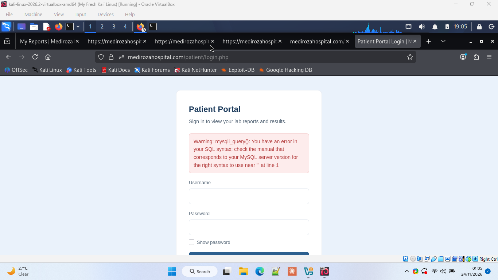
*Patient Portal login page returning a raw MySQL syntax error after a single quote was submitted.*

### MGH-02 — SQL Injection Payload
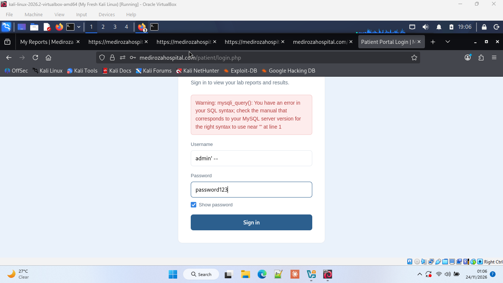
*The `admin' --` username payload entered into the login form.*

### MGH-02 — Successful Login Bypass
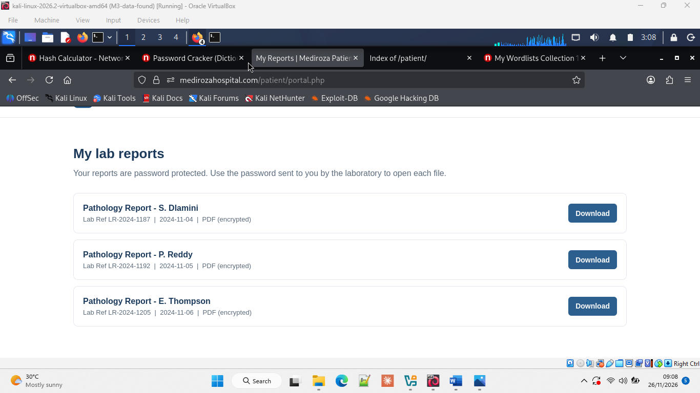
*The patient portal accessed successfully with no valid credentials.*

### MGH-03 — Patient Report Access
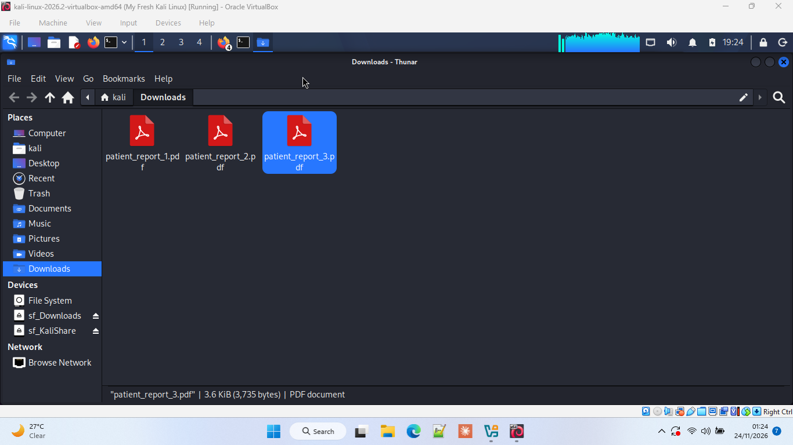
*Three patient pathology reports listed and downloadable from the portal.*

### MGH-04 — Weak PDF Passwords
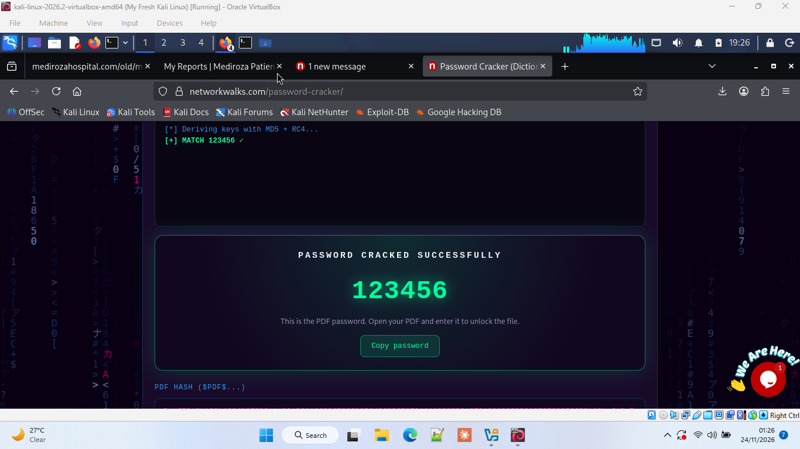
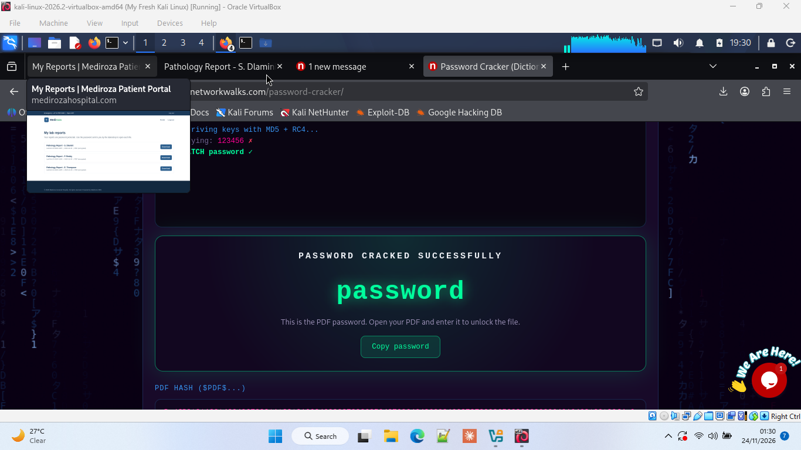
*Password-cracking output showing the first two PDF passwords recovered almost instantly.*

### MGH-04 — John the Ripper Cracking Result
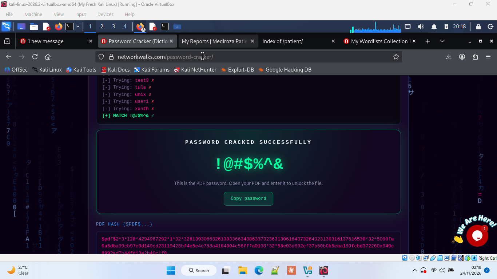
*John the Ripper recovering the third PDF's stronger password after the common-password list failed.*

### MGH-05 — Sensitive PDF Metadata
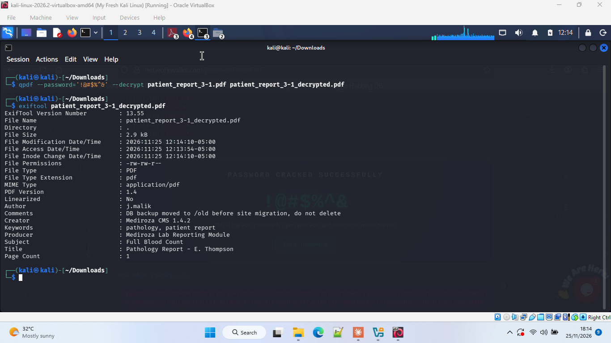
*ExifTool output revealing an internal staff comment referencing a database backup location.*

### MGH-06 — Directory Listing Exposing Backup
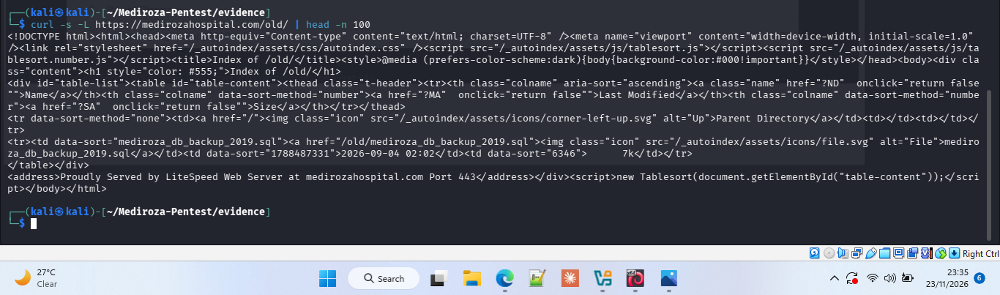
*Directory listing of `/old/` showing the database backup file publicly accessible.*

### MGH-07 — Database Schema
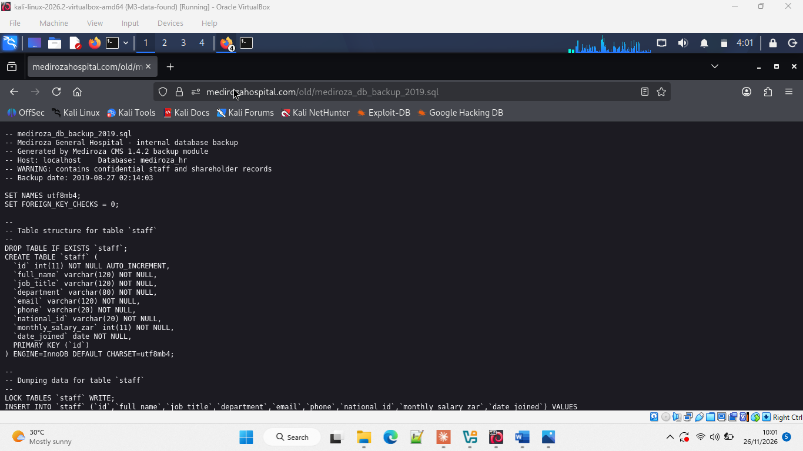
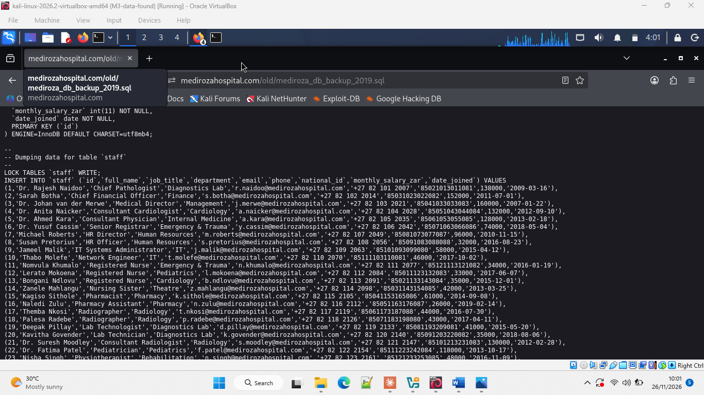
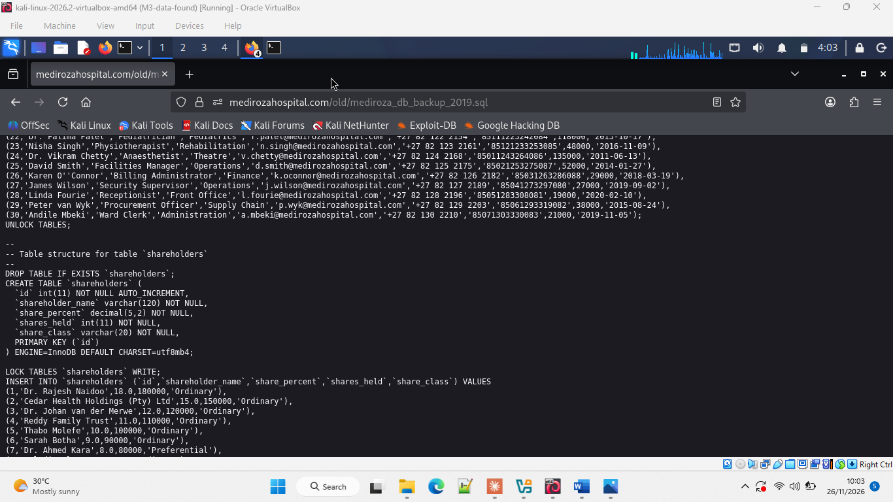
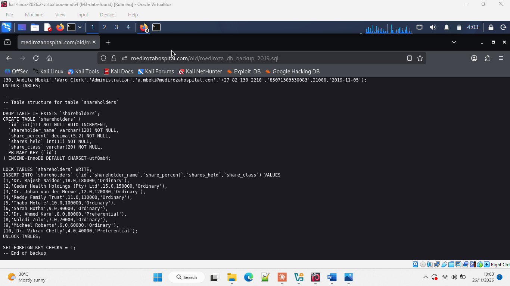
*Table structure of the exposed backup, showing the `staff` and `shareholders` tables in full.*

### MGH-07 — Database Records (Redacted)
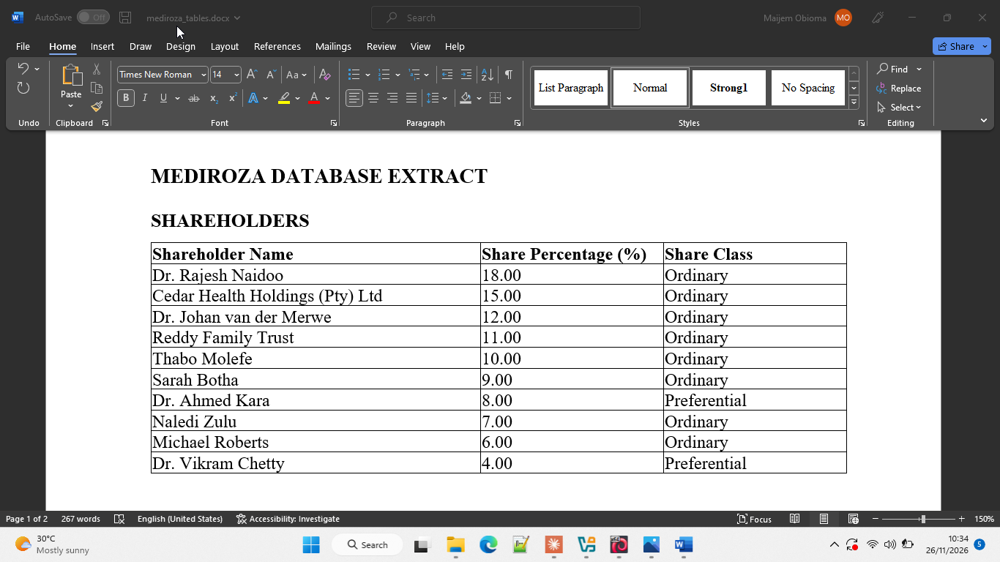
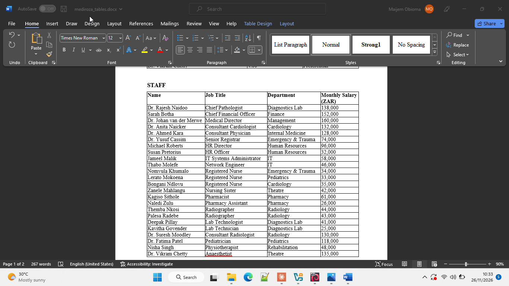
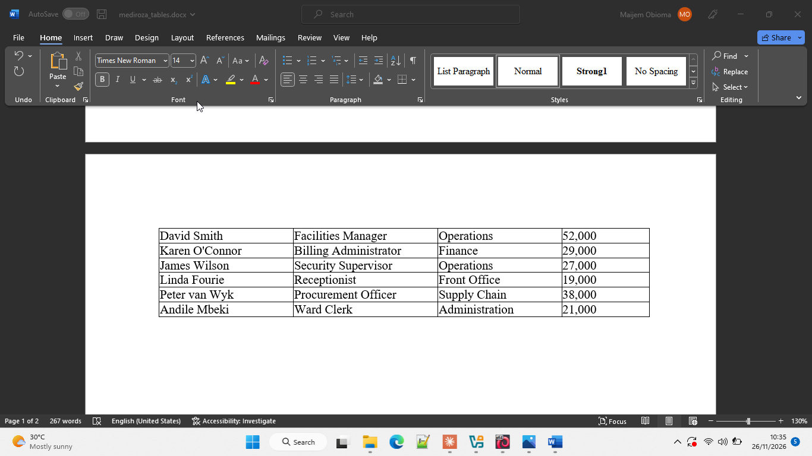
*Staff and shareholder data recovered from the backup, with national ID numbers redacted.*
---

## 🔗 Attack Chain Walkthrough

1. `patient/login.php` returned a raw MySQL error, confirming SQL injection (**MGH-01**).
2. The `admin' --` payload bypassed login entirely (**MGH-02**).
3. Three confidential patient PDFs became accessible in the portal (**MGH-03**).
4. Two PDFs were cracked instantly with weak passwords; the third required John the Ripper (**MGH-04**).
5. Metadata in the third PDF revealed a staff comment pointing to `/old` (**MGH-05**).
6. The `/old/` directory was publicly listed, exposing a database backup (**MGH-06**).
7. The backup revealed full staff and shareholder records in plain text (**MGH-07**).

```
SQL Injection → Login Bypass → Patient PDFs → Weak PDF Passwords
    → PDF Metadata Leak → Exposed Backup Directory → Full Database Exposure
```

---

## 💣 Impact

If exploited outside the controlled environment, this chain could enable an unauthenticated attacker to:

- Bypass authentication entirely and access the patient portal without any valid account.
- Download confidential patient lab/pathology reports belonging to named individuals.
- Recover the contents of password-protected medical documents using freely available tools.
- Discover internal infrastructure details through metadata left in a patient-facing document.
- Retrieve a complete, unprotected database backup containing staff PII, salaries, and shareholder ownership data.

🏛️ **Regulatory exposure:** Given the hospital's South African context, this incident would likely qualify as a reportable data breach under POPIA, given the exposure of health records, national ID numbers, and financial information.

---

## 💡 Lessons Learned

- A single unsanitized input field was enough to break authentication entirely.
- Error messages that reveal backend details give attackers a roadmap, even before any exploit is attempted.
- A password on a file means nothing if that password is short or common.
- Metadata is often overlooked, but it can carry real operational secrets.
- Old, forgotten files left in public directories can become the single point that exposes the most sensitive data in a system.
- No individual flaw here was "big" on its own — it was the combination of several small mistakes that led to a complete compromise.

---

## ✅ Conclusion

This assessment traced a single path from an anonymous login attempt to full exposure of confidential internal data, using nothing more than a handful of well-known, preventable weaknesses chained together. The Critical and High findings (MGH-01, MGH-02, MGH-06, MGH-07) should be treated as urgent and fixed before this system is trusted with real patient data.

---

## ⚠️ Disclaimer

This project was carried out as part of an authorized, controlled educational exercise under the Networkwalks B084 Cybersecurity Internship program. The target environment was explicitly set up and approved for this testing, and all actions described in this document were performed strictly within that agreed scope. None of the techniques, payloads, or steps described here should be used against any system without the owner's explicit written permission.

---

## 👤 Credits

- **Author:** Obioma ThankGod Chimaijem (Maijem)
- **Organization:** Networkwalks
- **Program:** B084 Cybersecurity Internship — Week 4 Capstone Project

---

**🔒 FOR EDUCATIONAL AND AUTHORIZED TESTING ONLY**
